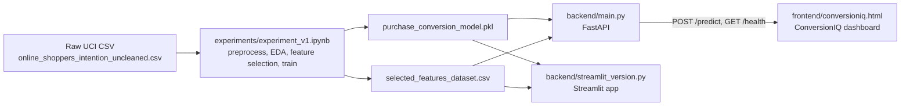

# Online Purchase Conversion Advisor (ConversionIQ)

An academic machine learning project that estimates how likely an online shopping session is to end in a purchase. A Logistic Regression model trained on the UCI Online Shoppers Purchasing Intention data is served through a FastAPI backend and used by a single-page web dashboard (**ConversionIQ**). A Streamlit version of the same prediction flow is also included.

---

## Table of Contents

- [Project Overview](#project-overview)
- [Key Features](#key-features)
- [Technology Stack](#technology-stack)
- [Project Architecture](#project-architecture)
- [Folder Structure](#folder-structure)
- [Prerequisites](#prerequisites)
- [Installation and Setup](#installation-and-setup)
- [Configuration](#configuration)
- [Data and Model Setup](#data-and-model-setup)
- [How to Run the Project](#how-to-run-the-project)
- [Usage Instructions](#usage-instructions)
- [API Documentation](#api-documentation)
- [Model Details](#model-details)
- [Screenshots](#screenshots)
- [Testing](#testing)
- [Troubleshooting](#troubleshooting)
- [Notes and Known Gaps](#notes-and-known-gaps)
- [Contributors](#contributors)
- [License](#license)

---

## Project Overview

Most visitors to an online store leave without buying. This project uses session-level browsing behaviour to estimate the probability that a session converts (the dataset's `Revenue` target), then turns that probability into a simple **conversion priority** (Low / Medium / High) to support decision-making.

The repository contains the whole workflow:

1. **Experiments** – a Jupyter notebook covering preprocessing, EDA, feature selection, train/test split, model training, a sample prediction and evaluation.
2. **Backend** – a FastAPI service that loads the trained model and returns a prediction for three session inputs.
3. **Frontend** – a static HTML dashboard that calls the API.
4. **Streamlit app** – an alternative UI for the same prediction flow.

The prediction form takes only **three** inputs (product-related pages, product-page duration, page value). All other model features are filled with the dataset median.

## Key Features

- **Purchase probability prediction** from three session inputs, using a trained Logistic Regression pipeline.
- **Predicted class** (`purchase` / `no_purchase`) and **conversion priority** (`low` / `medium` / `high`) based on fixed probability thresholds (≥ 70 % high, ≥ 40 % medium, otherwise low).
- **FastAPI backend** with `GET /health` and `POST /predict`, input validation and CORS configured for a local frontend.
- **ConversionIQ dashboard** (single HTML file, no build step) with:
  - Overview, Purchase Advisor, Session Analytics and Model Insights sections
  - Live API connection check and status indicator
  - Result panel with purchase / no-purchase likelihood and "session signals" bars
  - Dataset Explorer and Settings dialogs (API base URL, reduced animations, form reset)
  - Demo fallback that is **disabled by default**, so no made-up score is shown when the API is unreachable
- **Streamlit version** of the same flow (`backend/streamlit_version.py`).
- **Reproducible experiment notebook** with preprocessing, EDA charts, correlation-based feature selection, training and evaluation (accuracy, precision, recall, F1, ROC-AUC, confusion matrix, ROC curve).
- **Standalone training script** (`ml_models/train_model.py`) that trains a Logistic Regression pipeline and prints holdout metrics.

## Technology Stack

| Area | Technologies (taken from the project's imports and files) |
| --- | --- |
| Language | Python (notebook kernel: 3.13.5), HTML / CSS / JavaScript |
| Backend | FastAPI, Pydantic, CORS middleware |
| Machine learning | scikit-learn (`Pipeline`, `StandardScaler`, `LogisticRegression`, `ColumnTransformer`, `OneHotEncoder`), pandas, joblib |
| Visualisation (notebook) | matplotlib, seaborn |
| Alternative UI | Streamlit |
| Frontend | Plain HTML/CSS/JS in one file; Google Fonts (Inter, Space Grotesk) loaded from the web |
| Experimentation | Jupyter Notebook |
| Database | None |

## Project Architecture



**How a prediction works**

1. The user enters `pages`, `duration` and `page_value` in the dashboard.
2. The frontend sends them to `POST /predict` as JSON.
3. The backend builds a 16-feature row: every feature starts at its median in `selected_features_dataset.csv`, then `ProductRelated`, `ProductRelated_Duration` and `PageValues` are replaced by the user's values.
4. The pipeline (`StandardScaler` → `LogisticRegression`) returns the class and the probability of the positive (purchase) class.
5. The backend assigns the priority level and returns JSON, which the dashboard displays.

## Folder Structure

```
E-COMMERCE-PROJECT-1/
├── backend/
│   ├── main.py                        # FastAPI app (/health, /predict)
│   ├── streamlit_version.py           # Streamlit version of the prediction UI
│   └── purchase_conversion_model.pkl  # Trained scikit-learn pipeline (saved by the notebook)
├── frontend/
│   └── conversioniq.html              # ConversionIQ dashboard (single file)
├── experiments/
│   └── experiment_v1.ipynb            # Preprocessing, EDA, feature selection, training, evaluation
├── ml_models/
│   └── train_model.py                 # Standalone Logistic Regression training script
├── .gitignore                         # Ignores .venv, *.joblib, *.csv, __pycache__
└── README.md
```

> **Not in the repository:** all CSV files (they are git-ignored). That includes the raw dataset and `selected_features_dataset.csv`, which the backend needs. See [Data and Model Setup](#data-and-model-setup).

## Prerequisites

| Requirement | Notes |
| --- | --- |
| Python 3.9 or newer | The code uses `list[str]` type hints (3.9+). The notebook was run on Python 3.13.5. |
| pip | To install the Python packages |
| A static file server for the frontend | For example the VS Code **Live Server** extension, or Python's built-in `http.server` (see below) |
| Jupyter (optional) | Only needed to re-run the notebook |
| Internet access (optional) | The dashboard loads fonts from Google Fonts |

The repository has **no** `requirements.txt` or `package.json`. There is no Node.js dependency.

## Installation and Setup

1. **Get the code**

   ```bash
   git clone https://github.com/battulasandeepcsaiml25-spec/E-COMMERCE-PROJECT-1.git
   cd E-COMMERCE-PROJECT-1
   ```

2. **Create and activate a virtual environment**

   ```bash
   python -m venv .venv
   ```

   - Windows (PowerShell): `.venv\Scripts\Activate.ps1`
   - macOS / Linux: `source .venv/bin/activate`

3. **Install the Python dependencies**

   The packages below are the ones the code imports, plus `uvicorn`, which is needed to serve the FastAPI app. `scikit-learn` is pinned to **1.6.1** because that is the version stored inside the supplied `.pkl` file.

   ```bash
   pip install "scikit-learn==1.6.1" pandas joblib fastapi "uvicorn[standard]"
   ```

   Optional packages:

   ```bash
   pip install streamlit                       # for backend/streamlit_version.py
   pip install jupyter matplotlib seaborn      # to re-run the notebook
   ```

## Configuration

There are no environment variables, `.env` files, API keys or database settings. Configuration lives in the source files:

| Setting | Location | Default | Purpose |
| --- | --- | --- | --- |
| `allow_origins` | `backend/main.py` (CORS middleware) | `http://127.0.0.1:5500`, `http://localhost:5500` | Origins allowed to call the API. The frontend must be served from one of these, or this list must be edited. |
| `API_BASE_URL` | `frontend/conversioniq.html` (script) and the in-app **Settings** dialog | `http://127.0.0.1:8000` | Where the dashboard sends requests. |
| `ALLOW_DEMO_FALLBACK` | `frontend/conversioniq.html` (script) | `false` | When `true`, an illustrative formula (not the trained model) is shown if the API fails. Leave it `false` for real results. |
| `API_TIMEOUT_MS` | `frontend/conversioniq.html` (script) | `15000` | Request timeout. |
| `MODEL_PATH`, `DATA_PATH` | `backend/main.py` | `backend/purchase_conversion_model.pkl`, `backend/selected_features_dataset.csv` | Files loaded at startup. |
| Priority thresholds | `backend/main.py` and `backend/streamlit_version.py` | 0.70 / 0.40 | High / medium cut-offs. |

## Data and Model Setup

The backend loads two files from the `backend/` folder:

- `purchase_conversion_model.pkl` – **included** in the repository.
- `selected_features_dataset.csv` – **not included** (CSV files are git-ignored). Without it, `/health` and `/predict` return HTTP 503.

The dataset is the UCI *Online Shoppers Purchasing Intention* data. The notebook expects the raw file under the name `online_shoppers_intention_uncleaned.csv`. The repository does not contain this file, so you must supply it yourself.

To generate `selected_features_dataset.csv`:

1. Place `online_shoppers_intention_uncleaned.csv` in the same folder you start Jupyter from (the notebook reads and writes files using relative paths).
2. Open `experiments/experiment_v1.ipynb` and run the cells in order. The cells that matter for the backend are:
   - **Data Preprocessing** → writes `preprocessed_dataset.csv`
   - **Feature Selection** → writes `selected_features_dataset.csv`
   - **Train-Test-Split** → writes `X_train.csv`, `X_test.csv`, `y_train.csv`, `y_test.csv`
   - **Model Training** → writes `purchase_conversion_model.pkl`
3. Copy `selected_features_dataset.csv` into `backend/`. If you retrained the model, copy the new `purchase_conversion_model.pkl` there too.

> The notebook's prediction cell uses `input()` and waits for three comma-separated values (for example `10,300,10`).

## How to Run the Project

### 1. Start the backend (FastAPI)

```bash
cd backend
uvicorn main:app --reload
```

- API: `http://127.0.0.1:8000`
- Interactive docs (FastAPI default): `http://127.0.0.1:8000/docs`
- Health check: `http://127.0.0.1:8000/health` – should return `"status": "ok"`.

### 2. Serve and open the frontend

The backend only accepts requests from port **5500**, so serve the `frontend` folder on that port. Opening the HTML file directly from disk will not work, because the browser sends a different origin and the request is blocked by CORS.

Option A – VS Code Live Server: open `frontend/conversioniq.html` and click **Go Live** (default port 5500).

Option B – Python:

```bash
cd frontend
python -m http.server 5500
```

Then open `http://127.0.0.1:5500/conversioniq.html`.

### 3. (Alternative) Run the Streamlit version

`streamlit_version.py` loads the model and CSV from the **current working directory**, so run it from `backend/`:

```bash
cd backend
streamlit run streamlit_version.py
```

## Usage Instructions

1. Start the backend and open the dashboard as described above. The status pill in the header shows **API CONNECTED** when `/health` succeeds.
2. Go to **Purchase Advisor** and enter:
   - **Product-related pages** – number of product pages visited (whole number, ≥ 0)
   - **Product page duration** – time on product pages in seconds (≥ 0)
   - **Page value** – the dataset's `PageValues` feature (≥ 0)
3. Click **Predict Purchase**. The result panel shows the purchase likelihood, the no-purchase likelihood, the predicted class and the priority level. The "session signals" bars only visualise your inputs; they are not feature-importance scores.
4. Use **Settings** to change the API base URL, reduce animations or reset the form. **Dataset Explorer** shows summary figures for the dataset (static values written into the page; no CSV is loaded in the browser).
5. If the API is unreachable, the dashboard shows an error and does not substitute an estimate (unless you enabled `ALLOW_DEMO_FALLBACK`).

## API Documentation

Base URL: `http://127.0.0.1:8000`

### `GET /health`

Reports whether the model and dataset loaded correctly.

**200 OK**

```json
{
  "status": "ok",
  "model_loaded": true,
  "model": "purchase_conversion_model.pkl",
  "feature_count": 16
}
```

**503 Service Unavailable** – the model or `selected_features_dataset.csv` could not be loaded; `detail` contains the reason.

### `POST /predict`

**Request body (JSON)**

| Field | Type | Constraint | Maps to model feature |
| --- | --- | --- | --- |
| `pages` | integer | ≥ 0 | `ProductRelated` |
| `duration` | number | ≥ 0 | `ProductRelated_Duration` |
| `page_value` | number | ≥ 0 | `PageValues` |

```bash
curl -X POST http://127.0.0.1:8000/predict \
  -H "Content-Type: application/json" \
  -d '{"pages": 10, "duration": 300, "page_value": 10}'
```

**Response (200 OK)**

| Field | Type | Description |
| --- | --- | --- |
| `purchase_probability` | number (0–1) | Probability of the purchase class |
| `predicted_class` | string | `"purchase"` or `"no_purchase"` |
| `priority` | string | `"high"` (≥ 0.70), `"medium"` (≥ 0.40) or `"low"` |

```json
{
  "purchase_probability": 0.0,
  "predicted_class": "no_purchase",
  "priority": "low"
}
```

*(The values above only illustrate the response shape; real values depend on the model and the inputs.)*

**Other responses:** `422` for invalid input (standard FastAPI validation), `503` if the model or data is unavailable, `500` if prediction fails.

## Model Details

All figures below come from the saved outputs of `experiments/experiment_v1.ipynb`.

**Data**

| Step | Result |
| --- | --- |
| Raw dataset shape | 12,390 rows × 18 columns |
| After removing duplicates and filling missing values (median for numeric, mode for categorical) | 12,299 rows × 18 columns |
| Purchase / non-purchase sessions | 1,910 / 10,389 (15.53 % conversion) |

**Feature selection:** one-hot encoding (`drop_first=True`) followed by selecting features whose absolute correlation with `Revenue` is at least 0.05. This produced 16 features:

`Administrative`, `Administrative_Duration`, `Informational`, `Informational_Duration`, `ProductRelated`, `ProductRelated_Duration`, `BounceRates`, `ExitRates`, `PageValues`, `SpecialDay`, `Month_Mar`, `Month_May`, `Month_NOV`, `Month_Nov`, `VisitorType_New_Visitor`, `VisitorType_Returning_Visitor`

**Model:** `Pipeline(StandardScaler → LogisticRegression(max_iter=1000, class_weight="balanced", random_state=42))`, trained on an 80 / 20 stratified split (9,839 training rows, 2,460 test rows; `random_state=42`).

**Results**

| Metric | Value |
| --- | --- |
| Training accuracy | 85.95 % |
| Test accuracy | 85.37 % |
| Test precision (purchase class) | 52.06 % |
| Test recall (purchase class) | 72.77 % |
| Test F1-score (purchase class) | 60.70 % |
| Test ROC-AUC | 0.8849 |

**`ml_models/train_model.py`** is a separate, standalone script. It trains a Logistic Regression pipeline (scaling numeric columns and one-hot encoding categorical ones), prints holdout accuracy, ROC-AUC and a classification report, refits on all rows and saves `model.joblib` next to the script. The backend does **not** use this file; it loads `backend/purchase_conversion_model.pkl`. The script contains a hard-coded Windows path for `DATA_PATH`, which you must change before running it on your machine.

## Screenshots

No screenshots are included in the repository.

## Testing

No automated tests or testing framework are present in the repository. You can check the setup manually:

- Open `http://127.0.0.1:8000/health` and confirm `"status": "ok"`.
- Call `POST /predict` with the `curl` example above, or use the `/docs` page.
- Run the notebook's **Model Evaluation** cell to reproduce the metrics listed above.

## Troubleshooting

| Problem | Likely cause | Fix |
| --- | --- | --- |
| `/health` or `/predict` returns **503** with "Model/data unavailable" | `backend/selected_features_dataset.csv` is missing (CSV files are git-ignored) | Generate it with the notebook and copy it into `backend/` (see [Data and Model Setup](#data-and-model-setup)). |
| 503 with "columns do not match in name/order" | The CSV was generated from different data or settings than the model | Re-run the whole notebook and use the CSV and `.pkl` it produces together. |
| Dashboard shows "Prediction API unavailable" | Backend not running, wrong API URL, or CORS blocking the request | Start `uvicorn main:app --reload` in `backend/`, check the URL in **Settings**, and serve the frontend on port 5500 (or edit `allow_origins` in `backend/main.py`). |
| Works with the API in the browser's address bar but not from the page | Page opened via `file://` or served on another port | Serve `frontend/` on port 5500 as shown above. |
| `InconsistentVersionWarning` when loading the model | scikit-learn version differs from the one that saved the model (1.6.1) | `pip install "scikit-learn==1.6.1"`. |
| `uvicorn: command not found` | Virtual environment not active or `uvicorn` not installed | Activate `.venv` and run `pip install "uvicorn[standard]"`. |
| Streamlit shows "Required file not found" | App started from the wrong folder | Run `streamlit run streamlit_version.py` from inside `backend/`, with the `.pkl` and `.csv` in that folder. |
| `FileNotFoundError: Dataset not found` from `train_model.py` | Hard-coded Windows path | Edit `DATA_PATH` in `ml_models/train_model.py` to point at your `preprocessed_dataset.csv`. |
| Port 8000 already in use | Another process is using it | Start with `uvicorn main:app --reload --port 8001` and update the API URL in **Settings** (the CORS list refers to the frontend's port, not the API's). |

## Notes and Known Gaps

These are observations from the code, not implemented features or announced plans:

- No `requirements.txt`, `package.json`, tests, license file or screenshots are included.
- The dashboard's summary figures (12,330 sessions, 1,908 purchases, 15.47 %) are hard-coded in the HTML. They match the original UCI dataset, whereas the preprocessed dataset used for training has 12,299 sessions and 1,910 purchases (15.53 %).
- The notebook does not normalise text labels in `Month` and `VisitorType` (for example `Nov` and `NOV` appear as separate categories), which is why both `Month_Nov` and `Month_NOV` are among the selected features.
- The prediction form exposes only three of the 16 model features; the rest are fixed at dataset medians.
- Only Logistic Regression is trained in this repository.

## Contributors

Repository owner: [battulasandeepcsaiml25-spec](https://github.com/battulasandeepcsaiml25-spec). No other contributor information is present in the project files.

## License

No license file is included in the repository, so no license is specified.
